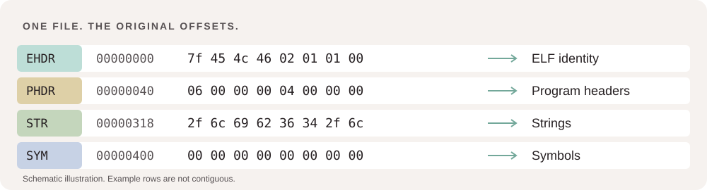

<h1 align="center">ELF hex viewer</h1>

<p align="center">The bytes stay in place. The structure becomes visible.</p>

<p align="center">
  
</p>

A read-only terminal viewer that explains ELF files directly on a continuous hex table. See file offsets, raw bytes and ASCII together, with small markers and notes for headers, sections, strings, symbols and more.

Instead of replacing the file with separate reports, it keeps the byte layout in view. Move to a byte to see what it means, search for a structure, or follow a field to the bytes it points to.

**Python standard library only · Read-only · Keyboard and mouse · Plain-text export**

## A look inside


*Captured from the current viewer running on a small compiled Linux demo, rendered in xterm.js. This is not a VS Code screenshot. Colors follow the terminal theme.*

- **Understand the layout.** Tags such as `EHDR`, `PHDR`, `SHDR`, `STR` and `SYM` identify the surrounding structure. Field markers and the bottom detail panel explain the selected bytes.
- **Navigate by meaning.** Search for `symbol table`, `.symtab`, `.strtab`, or a section name. If several structures match, choose the one you want.
- **Follow connections.** Press `Enter` on a field with a file-backed target, then `Backspace` to return.
- **Skip the empty stretches.** Fold eligible zero-filled content without changing the original file offsets.
- **Keep the raw view.** Export the annotated table as plain text for a terminal pipeline or your own notes.

## Quick start

### 1. Save the script

Save the viewer as `elf_viewer_mouse_wheel.py`. If your copy ends in `.py.txt`, remove the final `.txt` first.

You need Python 3 and a terminal with Python's `curses` support for the interactive view. No third-party Python packages are required.

### 2. Open an ELF file

Put the script beside your ELF file, or use full paths:

```bash
python3 elf_viewer_mouse_wheel.py ./main
```

The target file is opened for reading. It is **not executed or modified**.

Use a wide terminal: about **100 columns for hex and ASCII**, and **150 or more** to give the notes room. A UTF-8 terminal gives the clearest markers; `--ascii` is available if those characters do not render well.

### 3. Explore

1. Move over the hex or ASCII bytes with the mouse, or use the arrow keys. Read the selected field's explanation at the bottom.
2. Press `/`, type `symbol table`, then press `Enter`. For multiple matches, use `Up` / `Down` and `Enter` in the chooser.
3. Press `Enter` on a pointer field to follow it. Press `Backspace` to go back.
4. Press `q` to exit.

> After replacing the script with a newer copy, quit the running viewer with `q` and launch it again. Saving a file does not update a process that is already running.

## Read the table

<p align="center">
  
</p>

Each row holds up to **16 bytes**, in their original file order:

| Part | What it tells you |
| --- | --- |
| Tag | The surrounding structure: header, string table, symbol table, code, data, or another region |
| Offset | Where that row starts in the file, in hexadecimal |
| Hex + ASCII | The actual bytes, with a printable-character view alongside them |
| Notes | Field names, decoded values and structure boundaries |
| Bottom panel | Details for the selected byte or field, including a target when one is identified |

Markers appear **before** a byte. In the default character set, `┃` marks a region start, `│` marks a field start, and `»` marks a field with a target elsewhere. With `--ascii`, these become `#`, `|` and `>`.

Common tags: `EHDR` ELF header · `PHDR` program headers · `SHDR` section headers · `STR` strings · `SYM` symbols · `DYN` dynamic entries · `REL` relocations · `CODE` / `DATA` section content. A trailing `!` on a tag marks a warning on that row.

## Controls

| Key or action | Result |
| --- | --- |
| Arrow keys | Move the selection by byte or displayed row |
| `Page Up` / `Page Down` | Move by a screen of displayed rows |
| `Home` / `End` | Go to the first / last byte |
| Mouse move / left click | Inspect a byte in the hex or ASCII column |
| Wheel / two-finger scroll | Scroll 3 displayed rows per vertical report sent by the terminal; keep the pointer over the table or its notes |
| `/` | Search structures by name |
| `g` | Go to a hexadecimal file offset, such as `40` or `0x1040` |
| `Enter` | Follow the selected field's target, if available |
| `Backspace` | Return after a search, go-to or pointer jump |
| `n` / `N` | Next / previous annotated item |
| `z` | Fold or unfold the current eligible zero-filled range |
| `Z` | Collapse all eligible ranges; press again to expand all |
| `m` | Toggle mouse tracking; turn it off for normal terminal text selection |
| `w` or `i` | Show warnings and memory-only structures |
| `?` or `h` | Show help |
| `q` | Quit |

### Search for structures, not byte patterns

Try `ELF header`, `program headers`, `section headers`, `symbol table`, `string table`, `dynamic table`, `relocation table`, or a section name such as `.text`.

One match jumps directly to the structure. Multiple matches open a chooser with names, offsets and sizes. `Esc` or `q` cancels the chooser.

Search covers identified structures that have bytes in the file. It is not a full-text, symbol-name or arbitrary hex-pattern search. A stripped file may have no `.symtab`; the viewer does not invent one. Memory-only `.bss` is not treated as a file-backed byte range.

### Fold zeros without losing your place

The view starts expanded. Press `z` inside an eligible range, click its small `v` marker, or use `Z` to collapse all eligible ranges. Click a collapsed `>` summary to expand it.

A collapsed row keeps the **original start and end offsets, byte count and region name**. It does not delete bytes or renumber the file. Search, go-to and pointer jumps reveal hidden destinations automatically.

Only full 16-byte rows totaling at least 64 zero bytes inside a single eligible content region can fold. Structured metadata, strings, symbols and warned or ambiguous regions stay visible. Zero bytes are not automatically labeled as padding: a zero-filled section keeps its section identity.

## Plain-text mode

Export the same annotated byte table without opening the interactive view:

```bash
python3 elf_viewer_mouse_wheel.py --dump ./main
```

Show the first `0x80` bytes. Range values are hexadecimal; the end is exclusive. The start is rounded down to a 16-byte row boundary:

```bash
python3 elf_viewer_mouse_wheel.py --dump --range 0:80 ./main
```

Use ASCII markers and a shorter notes column:

```bash
python3 elf_viewer_mouse_wheel.py --dump --ascii --notes-width 80 ./main
```

Save a report:

```bash
python3 elf_viewer_mouse_wheel.py --dump ./main > main.annotated.txt
```

Dump mode always shows the bytes in the requested range without folding. When input or output is not a terminal, or `curses` is unavailable, the script falls back to plain-text output.

### Command-line options

| Option | Purpose |
| --- | --- |
| `--dump` | Print the annotated table and exit |
| `--range START[:END]` | Limit dump output to hexadecimal file offsets |
| `--ascii` | Use plain ASCII markers |
| `--no-mouse` | Start with mouse tracking off; `m` can toggle it later |
| `--no-color` | Disable interactive colors |
| `--notes-width N` | Set dump notes width; default: `110` |
| `-h`, `--help` | Show command-line help |

## Linux, SSH and VS Code

This is a **standalone terminal program**, not a VS Code extension. In a VS Code Remote-SSH session, save the script on the Linux host and run it in that host's integrated terminal. The ELF path must be accessible on that host.

Keyboard navigation does not depend on terminal mouse support. Hover and scrolling do: the terminal must forward the relevant mouse reports to the application. A multiplexer or terminal setting can filter them.

If mouse input does not behave as expected:

1. Confirm that you quit and relaunched after updating the script.
2. Check the header. `mouse: off` means tracking is disabled; press `m` to enable it. `mouse: requested` means tracking was requested but no report has arrived. `mouse: active` means some mouse input arrived, not necessarily a wheel report.
3. Keep the pointer over the byte table or its notes when scrolling. The header and bottom detail panel are not scroll areas in this version.
4. Try clicking, use the keyboard, or test a direct terminal if motion is filtered. Start with `--no-mouse` if you prefer keyboard-only use.

If the columns or markers look wrong, widen the terminal or try:

```bash
python3 elf_viewer_mouse_wheel.py --ascii --no-color ./main
```

## Scope and limits

- The parser handles ELF32 and ELF64 layouts, with little- and big-endian field decoding. The illustrated demo is a Linux x86-64 ELF file, not a test of every architecture or toolchain.
- The viewer annotates file structure. It is not a disassembler, debugger or binary editor.
- Files larger than **256 MiB** are shown only up to the first 256 MiB, with a partial-view warning. Some parsed tables and strings also have safety caps, so annotations are not a promise of exhaustive analysis.
- Malformed, overlapping, truncated or unrecognized data may produce warnings or remain raw. Press `w` to inspect warnings rather than assuming an unlabeled range has no meaning.
- Memory-only structures such as `SHT_NOBITS` do not gain invented file bytes. Unclaimed bytes are not automatically assumed to be empty padding.

---

*Made for learning the connection between ELF structures and the bytes that encode them.*
